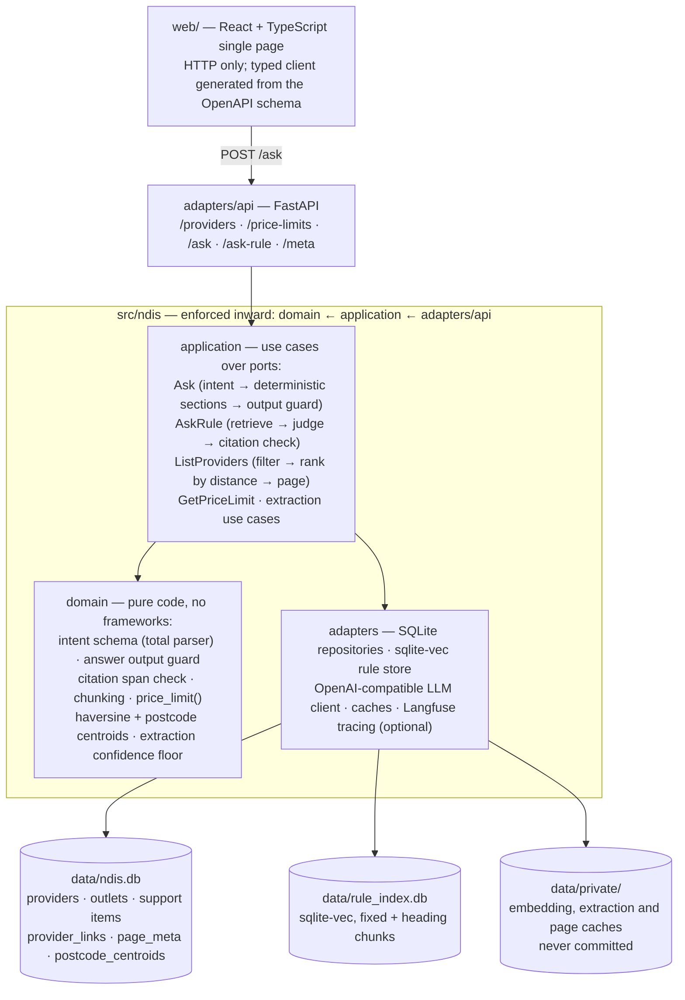

# NDIS Provider Navigator

Answers plain-language questions about NDIS providers and pricing over the real NDIS
Commission provider register: a question is parsed into a structured intent and executed
deterministically — register filters as SQL, price limits as a pure lookup in the official
support catalogue, pricing-rule questions answered only with citations that are verbatim
spans of the Pricing Arrangements document — and it refuses rather than guess. Where the
model is used to read a provider's website, every service claim ships with the verbatim
quote from that page and the register's own caveat that it does not record profession.
Python 3.12, FastAPI, Pydantic v2, SQLAlchemy 2, uv; the front end (`web/`, ticket 09) is
React 19 + TypeScript strict + Vite + Tailwind v4 with pnpm.

## Architecture



Four call sites go to the model — everything else is deterministic code:

| # | Call site | Where | Deterministic check behind it |
| --- | --- | --- | --- |
| 1 | Intent parse (question → JSON intent) | `POST /ask` | Total parser in `domain/intent.py`: an invalid part is dropped whole; `domain/answer.py`'s output guard re-checks the composed answer |
| 2 | Service extraction (provider website → service claims) | `scripts/extract_services.py` (cache, then served by `/ask`) | Confidence floor `MIN_SERVED_CONFIDENCE` in `domain/extraction.py`; every quote re-verified verbatim against the stored page at answer time |
| 3 | Rule judge (chunks → grounded answer or refusal) | `POST /ask-rule`, and the rule part of `POST /ask` | Similarity threshold refusal; every citation checked in `domain/pricing.py` to be a verbatim span of a retrieved chunk from the cited page |
| 4 | Embeddings (rule-index build, per-question retrieval) | `scripts/build_rule_index.py`, `AskRule` | Content-hash disk cache; cosine-similarity gate before any judge call |

Import-linter enforces the layering; `web/` reaches the API only over HTTP. Tracing
(Langfuse) wraps every model call site and is a no-op without keys.

## Data sources and licences

| Source | Used for | Licence / credit (checked 2026-11-10) |
| --- | --- | --- |
| [NDIS Commission registered provider CSV](https://www.ndiscommission.gov.au/provider-registration/find-registered-provider/download-csv) | Provider source of record (providers, outlets, registration groups, status) | [CC BY 4.0 Australia](https://www.ndiscommission.gov.au/copyright-and-disclaimer) — "© Commonwealth of Australia" |
| [NDIS Support Catalogue 2026-27 (XLSX)](https://www.ndis.gov.au/providers/pricing-and-payments/pricing/what-support-catalogue) | Price limits, support item numbers, registration groups | NDIA website material under CC Attribution–NonCommercial 3.0 ([NDIA copyright page](https://www.ndis.gov.au/policies-rules-and-legal/using-our-websites-and-social-media/copyright)); attribute the NDIA |
| [NDIS Pricing Arrangements and Price Limits 2025-26 v1.1 (PDF)](https://www.ndis.gov.au/providers/pricing-and-payments/pricing/pricing-arrangements) | The pricing-rule text the RAG index is built from | Same NDIA CC BY-NC 3.0 terms |
| [Australian postcodes CSV](https://github.com/matthewproctor/australianpostcodes) (Matthew Proctor) | Postcode centroids for distance ranking | The source repository carries no licence file; the author describes the dataset as free and "regarded as public domain" |
| Google Maps export of Brisbane providers (private) | Local bootstrap only: entity resolution and the page-collection seed | Owner's own export; lives under git-ignored `data/private/`, never committed |

The register is the provider source of record; the register does not record profession, so
services come from the provider's own website and are only ever shown with the quoted
evidence and the caveat sentence. Downloaded source data is never committed — only the
fetch scripts are.

Two Python dependencies are worth naming: `pymupdf` (PDF chunking) is dual-licensed
AGPL-3.0 or Artifex commercial — the only AGPL dependency — and `sqlite-vec` (the vector
index) is MIT/Apache-2.0. Both read from the installed package metadata. The rest of the
runtime stack (FastAPI, pydantic, SQLAlchemy, uvicorn, httpx, openpyxl, rapidfuzz,
trafilatura, langfuse) is MIT/BSD/Apache.

## Setup

Prerequisites: Python 3.12 with [uv](https://docs.astral.sh/uv/) (CI pins ≥ 0.13.7), Node
22 and pnpm (Corepack picks the exact version — if a global pnpm newer than the
`packageManager` pin refuses to run, `corepack prepare pnpm@11.11.0 --activate` once). No
key is needed to install, to run the unit/integration tests, or for the
register/catalogue/postcode bootstrap.

**Environment.** Copy `.env.example` to `~/.config/ndis/.env` and fill in
`LLM_BASE_URL` (a hosted OpenAI-compatible chat endpoint), `LLM_MODEL`, `EMBED_MODEL` and
`LLM_API_KEY`. The config module reads plain environment variables — there is no dotenv
loader — so source it per shell before any key-dependent command:

```sh
set -a; source ~/.config/ndis/.env; set +a
```

Optional: `LANGFUSE_PUBLIC_KEY` / `LANGFUSE_SECRET_KEY` enable tracing; `RULE_*`,
`NDIS_DB_PATH`, `WEB_DIST_DIR`, `EXTRACTION_DIR`, `PAGES_DIR` override defaults (see
`src/ndis/config.py` and `src/ndis/api/dependencies.py`).

**Public data** (downloads land in git-ignored `data/public/`, databases in `data/`):

```sh
uv sync --locked

uv run python scripts/fetch_public_data.py --only register    # ~85 MB CSV; browser-UA guarded
uv run python scripts/load_register.py                        # -> data/ndis.db (29,574 providers, 64,734 outlets)
uv run python scripts/fetch_public_data.py --only catalogue   # NDIS Support Catalogue 2026-27
uv run python scripts/load_catalogue.py                       # -> support_items (1,017)
uv run python scripts/fetch_public_data.py --only postcodes   # Matthew Proctor CSV
uv run python scripts/load_postcodes.py                       # -> postcode_centroids (3,173)
```

Every fetch is verified (minimum size, minimum distinct rows) and a bad download is
deleted, not kept. **Key-dependent:** the rule index needs the embedding endpoint:

```sh
uv run python scripts/fetch_public_data.py --only pricing_pdf
uv run python scripts/build_rule_index.py                     # ~460 chunks, paced minutes, pennies
```

**Private data (optional, local-only).** These steps fill in what the public sources
cannot: which Maps places are register providers (exact coordinates for distance), and
what each provider's website says it offers. All of them need the owner's Maps export as
`data/private/maps_brisbane.db` and write only into `data/private/` plus two tables in
`data/ndis.db` (`provider_links`, `page_meta`):

```sh
cp /path/to/maps-export.db data/private/maps_brisbane.db
uv run python scripts/resolve_entities.py                     # -> provider_links (see reports/entity_resolution.md)
uv run python scripts/collect_pages.py                        # polite fetch of provider pages (robots-aware)
uv run python scripts/extract_services.py                     # LLM extraction, cached per provider; key + quota
```

Without these, everything still runs: provider cards carry register facts and distances
only, and service evidence is simply absent (never invented). The full ~300-provider
extraction run has not been done — the measured results below are over ten labelled sites.

**Run:**

```sh
uv run uvicorn ndis.api.app:app --port 8000     # API on :8000; register_snapshot_date from data/public/register.csv
pnpm --dir web install
pnpm --dir web build                            # once, then restart uvicorn — the page is served at /
```

Then check, in order: `GET /meta` (configured models and data dates), `GET
/providers?near=4101&max_km=5&limit=5` (ranked by distance), `GET
/price-limits?item=15_056_0128_1_3&state=QLD` (catalogue limit, no model involved), and
`POST /ask` with a question (needs the key; the rule part degrades to a refusal with
reason `no_chunks` until `build_rule_index.py` has run). `POST /ask` with
`"Which provider is best for my autistic child? Recommend one."` must refuse with reason
`decision_request` — that refusal is the product.

`docs/demo.md` is a five-minute demo script over these endpoints; `docs/recording-checklist.md`
turns it into a 3-minute screen recording.

**Tests and evals:**

```sh
uv run pytest                     # unit + integration; LLM mocked; no key, no data
uv run pytest -m eval --no-cov    # the eval gate; replays committed captures, no quota
```

The eval gate enforces the floors in `evals/thresholds.yaml`. Suites that need `data/`
(the register DB, the rule index, the private caches) skip with a visible notice when it
is absent — CI never claims they passed. The gate spends no model quota: it replays
committed captures and disk caches. Model calls made outside the gate (serving, index
build) go through the hosted free tier, which throttles per minute and per day; the
adapter retries and then fails loudly (HTTP 502), never degrades silently. Known wart:
`evals/test_extraction.py` creates an
empty `data/ndis.db` as a side effect, which can un-skip the register-backed suites on a
later data-less run (listed under "Not built yet").

**Development gates** (run before finishing any change; see `AGENTS.md`):

```sh
uv run ruff check . && uv run ruff format --check . && uv run mypy && uv run lint-imports && uv run pytest
uv run python scripts/check_no_stubs.py
uv run python scripts/check_private_data.py --tracked
pnpm --dir web check   # when web/ changed
```

`uv.lock` is resolved against PyPI by CI, which fails when the committed file differs; on
a machine that resolves through a mirror, `git update-index --skip-worktree uv.lock` and
restore the CI artifact (details in `docs/harness/STATE.md`).

## Measured results

Numbers are copied from the reports; each table names its source. Thresholds live in
`evals/thresholds.yaml` and are never lowered to make a run green.

**Service extraction** — per-service macro precision/recall over ten hand-labelled
provider sites, LLM vs the earlier regex baseline (source:
[reports/extraction.md](reports/extraction.md), 2026-11-09 run):

| | LLM | regex baseline |
| --- | --- | --- |
| macro precision | **84%** | 56% |
| macro recall | 90% | 93% |

The baseline is scored on a different corpus (the Maps crawl's slug hits), so its higher
recall partly measures the crawler's reach. Serve time applies the measured
confidence floor (`MIN_SERVED_CONFIDENCE` = 0.75 in `domain/extraction.py`): every claim
below the floor on the labelled set was an expression of interest, not an offered service;
without the floor precision is 73.2% and recall identical.

**Pricing-rule retrieval** — hit@3 over ten golden questions whose cited page was verified
against the PDF (source: [reports/retrieval.md](reports/retrieval.md)):

| chunking strategy | chunks | hit@3 |
| --- | --- | --- |
| fixed 600-token windows | 175 | 10/10 |
| heading-aware | 284 | 10/10 |

Refusal gate: the on-topic floor is top-1 similarity 0.751 (weakest golden question), the
off-topic band tops out at 0.620; the threshold is 0.65, with the judge and the verbatim
citation check behind it.

**Eval gate** (source: `evals/thresholds.yaml` header notes; enforced by `pytest -m eval --no-cov`):

| metric | floor | measured |
| --- | --- | --- |
| filter accuracy (12 golden /ask filter cases, exact match) | 0.85 | 12/12 = 1.0 |
| rule hit@3 | 0.7 | 1.0 (both strategies) |
| extraction macro precision (labelled sites, served claims) | 0.8 | 0.840 |
| refusal recall (5 golden refusal/adversarial cases) | 1.0 | 5/5 = 1.0 |

**Latency and cost** (source: [reports/cost.md](reports/cost.md), 2026-11-09 runs through
the free tier of the configured hosted endpoint; dollars are what the measured usage would
cost at published list prices):

| pipeline step | n | p50 s | p95 s |
| --- | --- | --- | --- |
| intent parse (`POST /ask`) | 3 | 1.3 | 1.8 |
| rule judge + answer (`POST /ask-rule`) | 3 | 1.7 | 2.6 |
| question embedding (retrieval gate) | 2 | 0.7 | 2.2 |
| service extraction (per page) | 3 | 1.4 | 1.6 |

Cost over the golden set: intent parse $0.0056, rule-judge calls $0.0478 (measured, 50
calls), extraction over the ten labelled sites $0.0484 (46 page calls), embeddings
$0.0001. The eval gate itself costs nothing at run time — it replays committed captures.
Judge-faithfulness agreement (agent labels vs the model judge on served answers):
7/10 = 0.70, with 10 of 20 template rows still awaiting owner labels — full judge
validation is not done (below).

## Not built yet

Honest list; nothing here should be assumed from the demo:

- Fuzzy vector name match — provider names are matched exactly (domain, normalised name,
  registered-Maps links); no fuzzy/vector name search for "something like".
- Model routing — one configured model serves every step; no cheap/fast routing or
  fallback selection.
- Multi-turn conversations — `POST /ask` is one question in, one answer out.
- Auth and rate limits — the API is unauthenticated and unthrottled; not for deployment.
- PAPL version tracking — the rule index is built from PAPL 2025-26 v1.1; a new release
  means re-fetching and rebuilding by hand (`PRICING_PDF_URL` in
  `scripts/fetch_public_data.py`).
- Full judge validation — 10 of the 20 `evals/judge_verdicts.yaml` rows await owner
  labels; agreement is 0.70 over the agent-labelled ten only.
- Nearest-outlet distance origin — a provider matched via a Brisbane outlet but with an
  interstate head office is measured from the head-office postcode centroid; nearest
  outlet would be better.
- `exact_coordinates()` loads all registered provider links per request (fine at 223, an
  obvious per-request query otherwise).
- `/providers` SQL latency is ~3–9 s/query (register-scale join, pre-existing; `near`
  ranking itself is ≈8 ms over 29,574 providers).
- `evals/test_extraction.py` creates an empty `data/ndis.db` as a side effect, which can
  un-skip the register-backed eval suites on a later data-less run.
- Textarea border contrast 1.23:1 vs WCAG 1.4.11 in the web form.
- The full ~300-provider extraction run is pending (≈ $1.34 at list prices, paced after
  quota resets).

## Learning notes

One note per ticket under `docs/learning/` — decisions, rejected alternatives, numbers:
[start here](docs/learning/LEARNING_LOG.md). Repo/harness state:
[docs/harness/STATE.md](docs/harness/STATE.md).

## Delivery harness

One issue, worktree, branch and squash-merged PR per ticket; CI must be green and an
independent Reviewer agent posts `APPROVE` on the PR before merge (`main` requires the
`quality` and `web` checks). Nothing under `data/private/` is ever committed — the
pre-commit hook blocks staging it and CI checks tracked paths; `git log --all -- data/private`
must stay empty.
