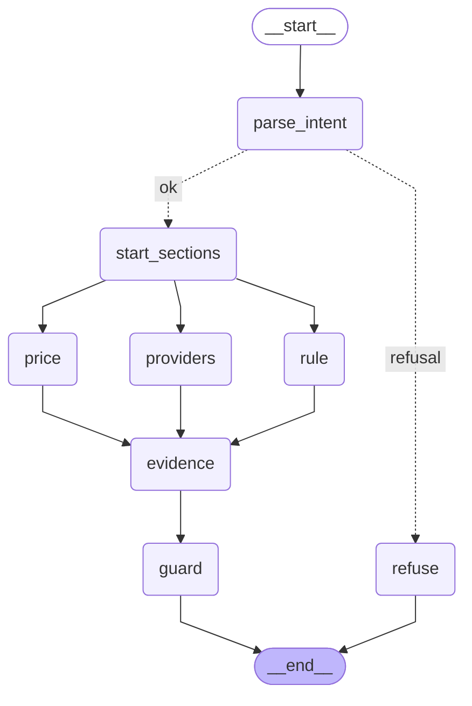

# The ask graph

Generated by `scripts/run_ask_graph.py --diagram` from `build_ask_graph` in
`src/ndis/adapters/graphs/ask_graph.py`; a test fails when this file drifts from the
diagram the code generates (`tests/test_ask_graph.py`). The dashed edges are the
conditional edge after `parse_intent`: a pre-execution refusal, or the three parallel
sections joined once at `evidence`.

