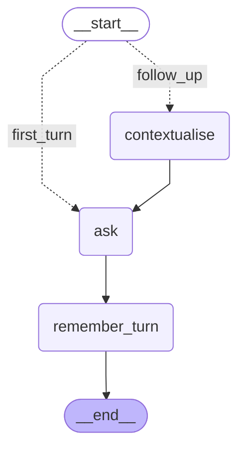

# The chat graph

Generated by building `build_chat_graph` in `src/ndis/adapters/graphs/chat_graph.py`
(no node runs while building); a test fails when this file drifts from the diagram the
code generates (`tests/test_chat_graph.py`). The dashed edges are the conditional edge
from START: a thread with no completed turn yet goes straight to `ask` (one model call),
a follow-up turn is rewritten by `contextualise` first (two model calls). The `ask` node
runs the ticket 15 ask graph — invoked inside the node function, compiled with
`checkpointer=False`, so its state (which carries page text) is never checkpointed; only
the outer chat state, which holds JSON-plain values only, is ever saved.

