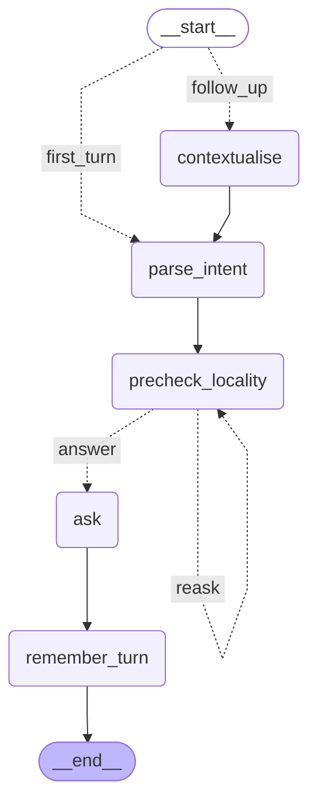

# The chat graph

Generated by building `build_chat_graph` in `src/ndis/adapters/graphs/chat_graph.py`
(no node runs while building); a test fails when this file drifts from the diagram the
code generates (`tests/test_chat_graph.py`). The dashed edge from START is conditional:
a thread with no completed turn yet goes straight to `parse_intent` (one model call), a
follow-up turn is rewritten by `contextualise` first (two model calls). The
`precheck_locality` node resolves the question's suburb purely (the provider section's
planning: the postcode guard and the deterministic gazetteer lookup, no model call and
no write — on resume LangGraph re-runs the node from its first line, so everything above
the interrupt runs twice); when the suburb is ambiguous with no stated postcode to carry
the filter it pauses the run with the candidates, and its dashed self-loop re-asks the
same question when a resume answer names none of the offered options. A valid choice is
written to the state and `ask` pins the pipeline's provider query with it. The `ask` node
runs the ticket 15 ask graph — invoked inside the node function, compiled with
`checkpointer=False`, so its state (which carries page text) is never checkpointed, and
fed the already-parsed intent and parse step so a resumed turn never parses twice; only
the outer chat state, which holds JSON-plain values only, is ever saved.

